# LEETO App - Complete UI & Feature Showcase

This document captures high-resolution screenshots of every user interface, interactive modal, analytics view, and workflow within the **LEETO** mobile application.

---

## 1. Authentication & Onboarding

### Sign In
The authentication screen features a clean, focused dark-mode interface with email and password fields, input validation, bcrypt-secured authentication against the SQLite database, guest mode entry, and sign-up navigation.

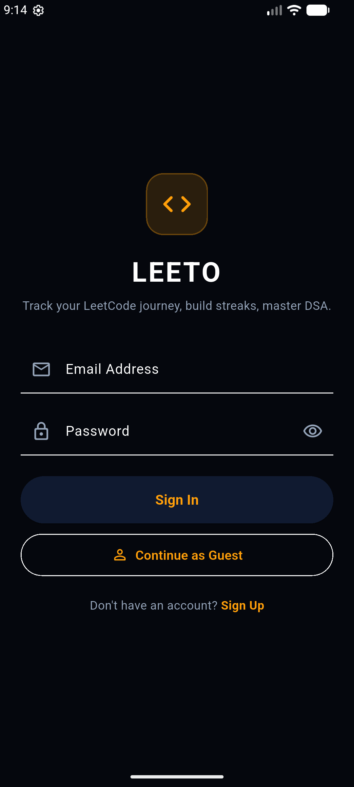

---

### Sign Up / Registration
The account creation screen gathers the user's Display Name, Email Address, Password, and LeetCode Username, enabling automatic synchronization of live LeetCode stats and submission history upon registration.

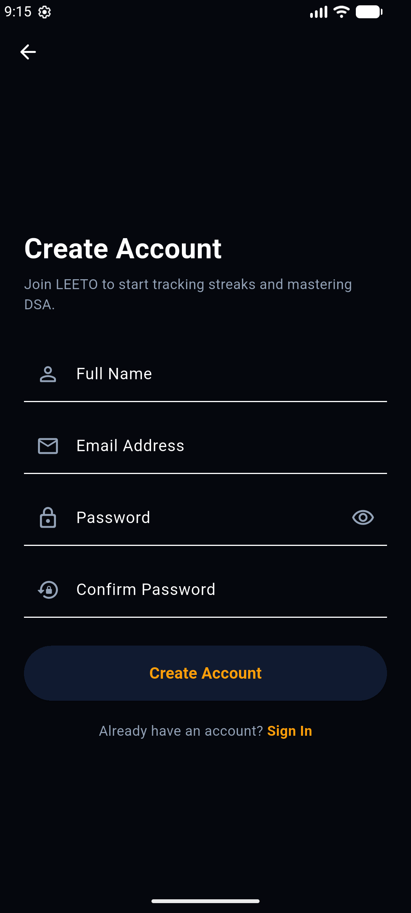

---

## 2. Main Dashboard & Leaderboard

### Dashboard Overview & Daily Challenge
The top section of the dashboard highlights the **Daily Challenge** ("Minimum Operations to Sort a Permutation", difficulty badge, tag, solved counter, and "Solve Now" deep-link button), the **Live Team Activity** banner, search field, quick filter chips (`+ Add`, `Solved`, `Streak`, `Accuracy`), and the **Rank 1 Teammate Card** crowned with a gold border and badge.

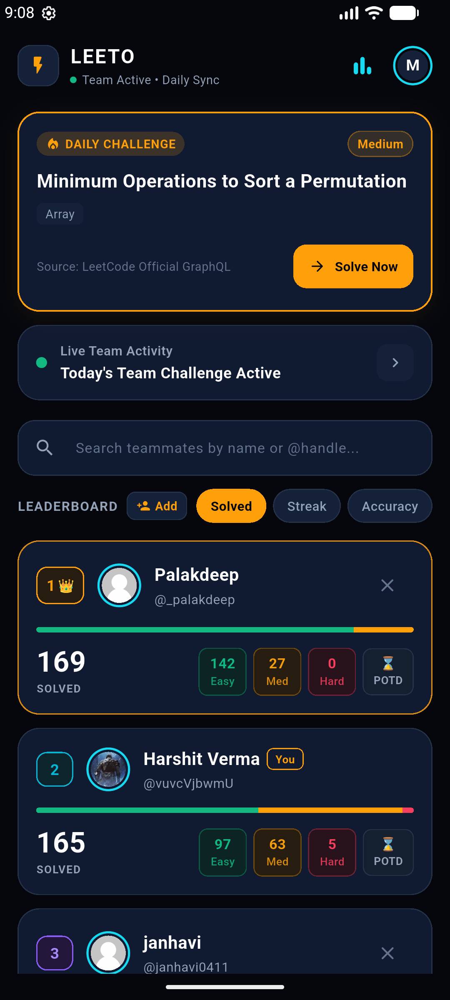

---

### Full Teammate Leaderboard
A smooth scrolling list showcasing all teammates in the group with rank badges, handles, total problems solved, active streaks, POTD completion indicators, accuracy percentages, color-coded difficulty distribution progress bars, and one-tap delete cross buttons.

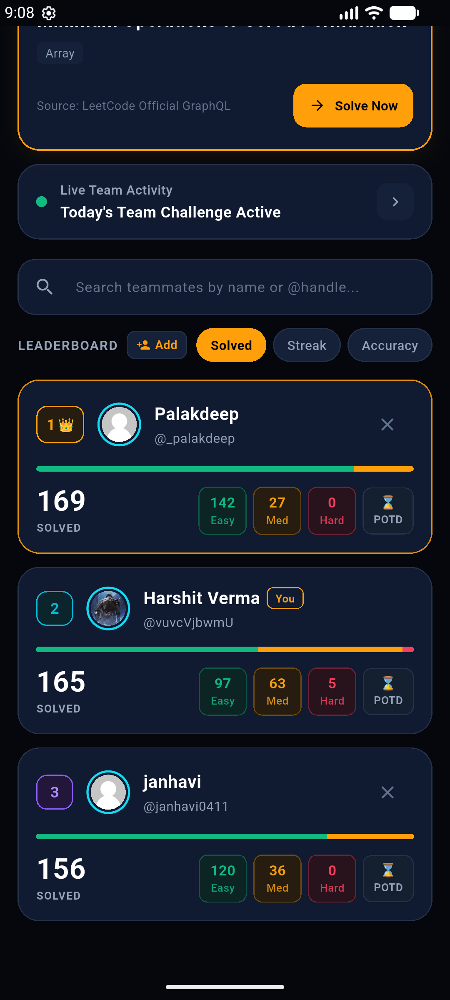

---

### Live Search & Instant Filtering
Typing into the search bar instantly filters the teammate roster in real time (e.g. searching `"palak"` shows matching users with zero lag).

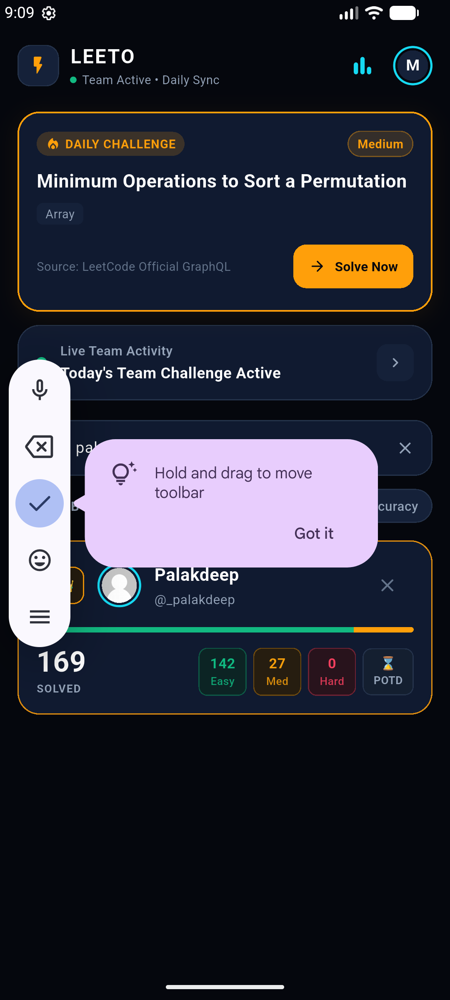

---

### Dynamic Sorting (Streak, Solved, Accuracy)
Tapping any filter chip re-sorts the entire leaderboard immediately. Below, sorting by **Streak** surfaces teammates with the longest active LeetCode daily streaks at the top.

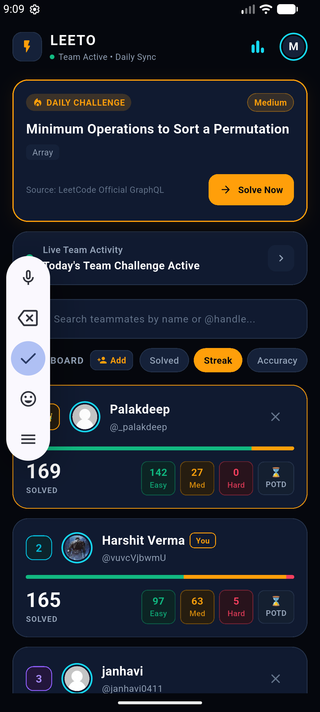

---

## 3. Teammate Management & Modals

### Add Teammate Modal
A sleek bottom sheet modal triggered from the `+ Add` button that allows adding any peer by their LeetCode username. It validates the handle against the backend and syncs their profile data into the user's personal team roster.

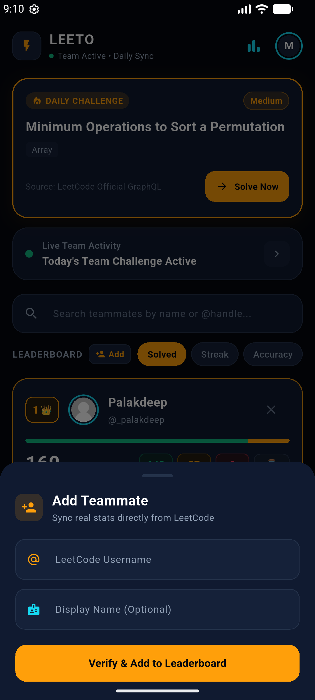

---

### Remove Teammate Confirmation Dialog
Tapping the cross (`✕`) button on any teammate card prompts a confirmation dialog preventing accidental deletions while giving users full control over their roster.

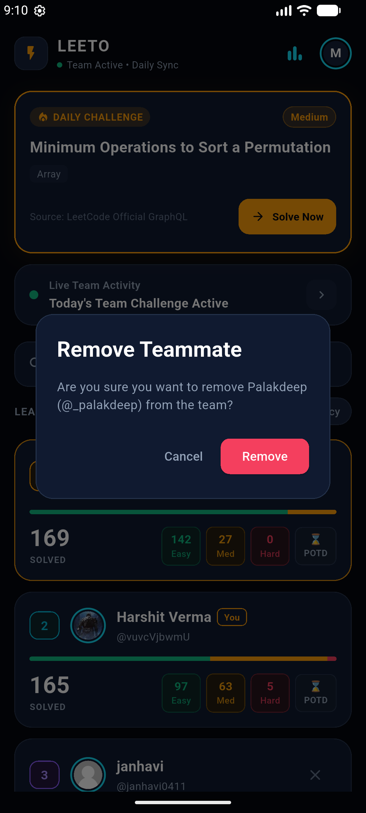

---

## 4. Teammate Analytics & Deep Dive

### Detail View: Overview & Difficulty Distribution
Tapping any teammate card navigates to their comprehensive profile deep dive. The header presents total solved count (e.g. 169), accuracy percentage (68%), contest rating (1,620), and a granular difficulty breakdown into Easy, Medium, and Hard counts.

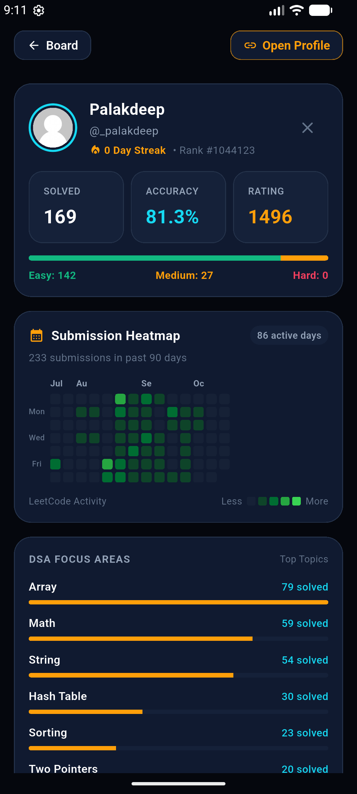

---

### Detail View: 90-Day Submission Heatmap & Topic Breakdown
A GitHub/LeetCode-style 90-day activity heatmap visually maps daily problem solves with intensity levels, followed by a breakdown of DSA Focus Areas (Array, String, Hash Table, Math, Dynamic Programming).

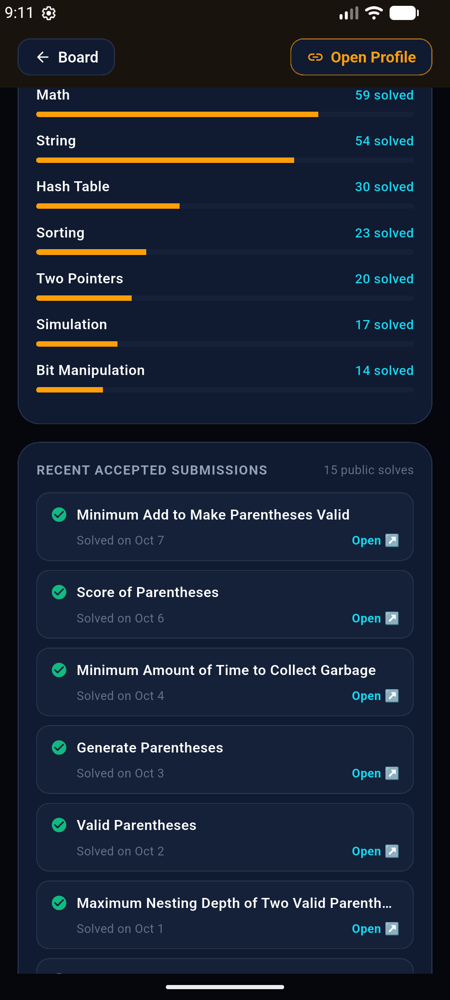

---

### Detail View: Recent Submissions Timeline
A live feed of the teammate's most recent LeetCode submissions with problem titles, acceptance status badges, relative timestamps ("4 days ago", "1 week ago"), and direct links to view the problem.

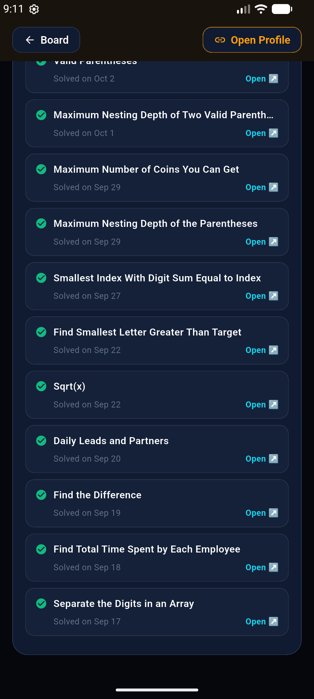

---

## 5. Personal Analytics, Activity & Settings

### Weekly Progress
A weekly analytics view featuring a **Solves by Day** bar chart, Active Days tracker (e.g. 0/7), Goal Met status, and Daily Average statistics to keep developers accountable.

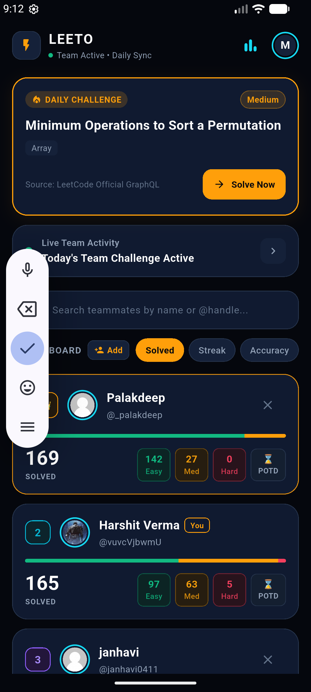

---

### Live Team Activity Feed
Dedicated team activity dashboard showing active group challenge status and real-time updates of teammate solves.

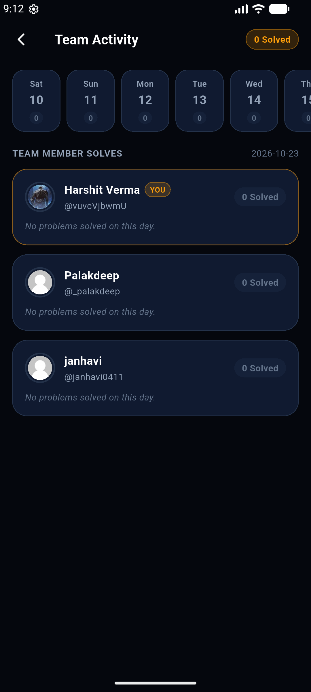

---

### User Profile ("My Profile")
The user's personal profile displaying verified LeetCode handle badge (`@vuvcVjbwmU`), 133 active days submission heatmap, solved problem statistics, and account Sign Out action.

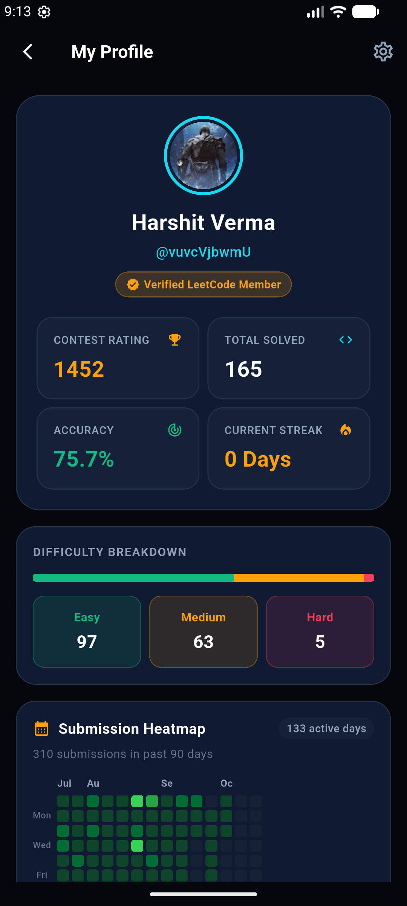

---

### Application Settings
A settings panel allowing users to configure daily problem goals, toggle daily practice push reminders, adjust reminder times (e.g. 8:00 PM), and manage account credentials.

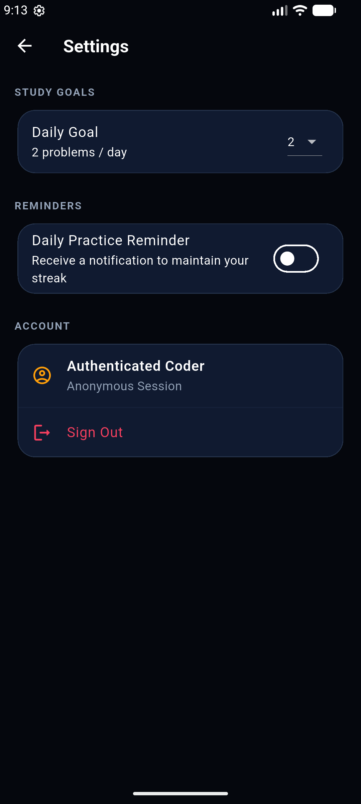
