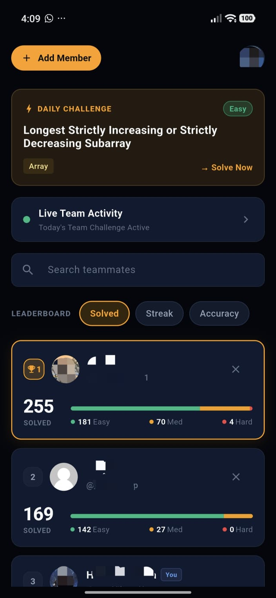
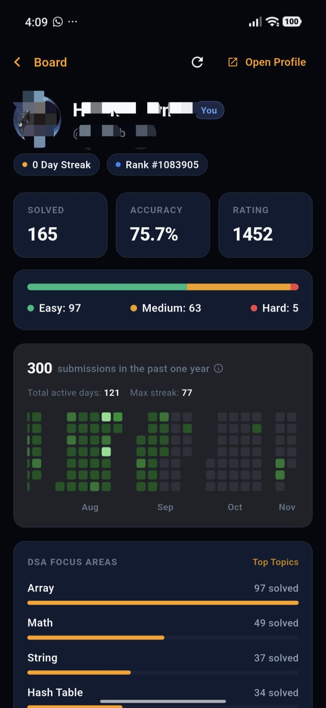
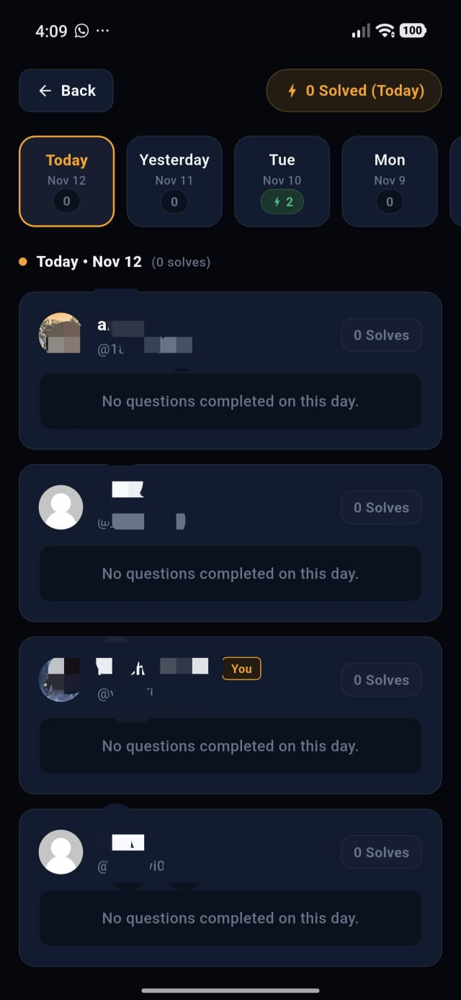

<div align="center">

# 🚀 LEETO

### Track your LeetCode squad. Never miss a solve.

A Flutter app to follow teammates' LeetCode progress, with instant push alerts for every Accepted submission.


</div>

---

## ✨ Features

- 👥 **Team Tracking** – Add your profile and your teammates
- 🏆 **Leaderboard** – See who's solving the most
- 📊 **Stats** – Problem-solving insights at a glance
- 🔥 **Heatmaps** – LeetCode-style contribution calendar
- 📰 **Activity Feed** – Recent team submissions
- 🔔 **Push Alerts** – Notified when a teammate gets an Accepted solution

---

## 📸 Screenshots & Download

<div align="center">

   

### 📥 Try the app on Android

[](https://github.com/Harshitverma677/leettrack_app/releases/latest)

</div>

**Install steps:**
1. 📥 Download the latest `.apk` from [Releases](https://github.com/Harshitverma677/leettrack_app/releases/latest)
2. ⚙️ Allow **Install from unknown sources** when prompted
3. 🚀 Open the app and start tracking!

---

## 🛠️ Tech Stack

| Area | Tech |
| --- | --- |
| 📱 App | Flutter, Dart |
| 🔐 Auth & Data | Firebase Auth, Cloud Firestore |
| 🔔 Notifications | Firebase Cloud Messaging |
| 🌐 Data Source | LeetCode public GraphQL |
| ☁️ Hosting | Render, cron-job.org |

---

## 🧠 How It Works

```
cron-job.org ➜ Backend polls LeetCode ➜ Accepted? ➜ Dedup check ➜ FCM push ➜ 📱 You
```

- Each tracked username is polled **once per cycle**
- Only **Accepted** submissions trigger alerts
- Firestore deduplication prevents **duplicate notifications**

🔗 **Backend repo:** [leeto-push-notifications](https://github.com/Harshitverma677/leeto-push-notifications)

---

## ⚡ Getting Started

### 📱 Run the app

```bash
git clone https://github.com/Harshitverma677/leettrack_app.git
cd leettrack_app
flutter pub get
flutter run
```

### ⚙️ Run the backend

```bash
git clone https://github.com/Harshitverma677/leeto-push-notifications.git
cd leeto-push-notifications
npm install
cp .env.example .env
npm run dev
```

Health check: `GET http://localhost:3000/health`

---

## 🔌 Backend API

| Method | Endpoint | Purpose |
| --- | --- | --- |
| `GET` | `/health` | Check server status |
| `POST` | `/internal/run-poll` | Run one polling cycle (Bearer token required) |

---

## 🔒 Security

- 🚫 Never commit `.env` or service-account JSON files
- 🔑 Keep `POLL_SECRET` private
- 🛡️ Keep FCM credentials on the backend only

---

<div align="center">

### 👨‍💻 Built by [Harshit Verma](https://github.com/Harshitverma677)

⭐ Star this repo if you like it!

</div>
